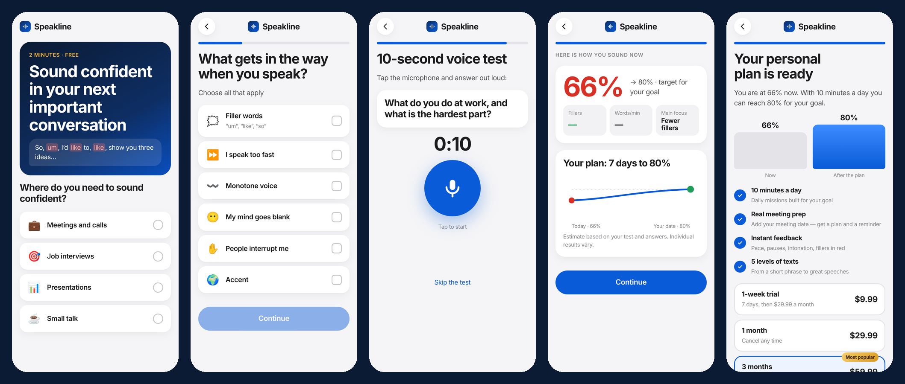
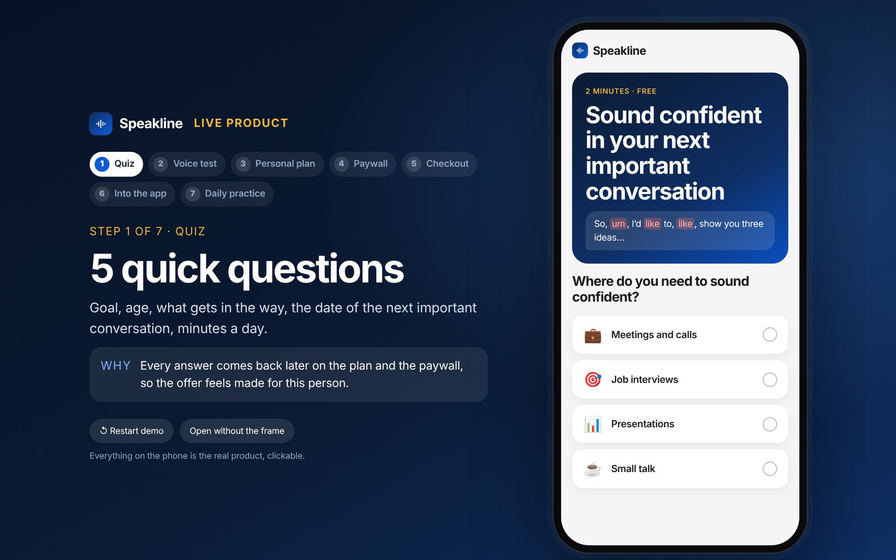

# Speakline — speaking coach for your next important conversation

**Practise out loud, get instant feedback on pace, pauses and filler words, and follow a plan built around the date of your interview, pitch or call.**

Speakline is a web-first speaking coach: a 2-minute quiz and a 10-second voice test turn into a personal plan, a web paywall, and daily 10-minute practice with an AI coach. It is built and sold on the web (web2app), so there is no app-store fee.

> Capstone project, Zimran IT School (Team 2). A working product, not a mockup: real speech recognition, real checkout in Paddle sandbox, a backend with tests, and a unit-economics model behind every growth decision.



## Try it

| | |
|---|---|
| ▶️ **Web funnel** (start here) | [daulet-tuzelbek.github.io/Speakline/start](https://daulet-tuzelbek.github.io/Speakline/start/) |
| 📱 **App** | [daulet-tuzelbek.github.io/Speakline](https://daulet-tuzelbek.github.io/Speakline/?app=1) |
| 🖥 **Desktop demo** | open either link on a laptop: the live product runs inside a phone frame, with a side panel explaining each funnel step |

Use Chrome (desktop or Android) or Safari on iPhone and allow the microphone. Payments run in **Paddle test mode**: card `4242 4242 4242 4242`, any future date, CVC `100`.



## The problem

People with an important conversation on the calendar — a job interview, a pitch, a client call — know they will rush, freeze or say "um", but have no structured way to practise before the date. Existing apps either train the voice in general or sell content without live speaking practice.

Speakline does one thing: **live speaking practice plus a plan to your date.**

## How the funnel works

| # | Step | What happens | Why it matters |
|---|---|---|---|
| 1 | **Quiz** | 5 questions: goal, what gets in the way, date of the next important conversation, minutes a day | Every answer comes back on the plan and the paywall, so the offer feels personal |
| 2 | **Voice test** | 10 seconds out loud; filler words and words per minute counted live | The "aha" moment comes before any payment |
| 3 | **Personal plan** | Test result → score, main focus, days to reach 80% by the meeting date | A vague wish becomes a concrete goal with a deadline |
| 4 | **Paywall** | Email, then three plans; renewal terms shown before the button | Primary metric: payers ÷ paywall views; guardrails: refunds and disputes |
| 5 | **Checkout** | Paddle card form inside the page, no sign-up step | Paddle is merchant of record: VAT, sales tax and chargebacks handled |
| 6 | **Into the app** | Plan is active the moment the app opens | Paying on the web avoids the 15–30% app-store fee |
| 7 | **Daily practice** | Missions for the user's goal, instant feedback, AI coach, reminder before the meeting | Retention drives LTV |

## Product features

- **Live speech analysis** — pace (words per minute), pauses, intonation and filler words, highlighted in red as you speak
- **Three languages** — English, Russian, Kazakh
- **AI coach** — after each answer, a breakdown of the metrics and the text with concrete advice (Premium, rate-limited)
- **Plan to a date** — daily missions sized to the time the user has before the meeting
- **5 levels of texts** — from a short phrase to a full speech
- **Light and dark mode**, phone-first layout, works in the browser with nothing to install

## Growth & unit economics

The product was designed together with its go-to-market. The full model is in [`capstone/capstone_sheet.csv`](capstone/capstone_sheet.csv): every input is tagged as a course default, a sourced benchmark or our own assumption with a reason.

**Base case (US only, cautious):**

| Metric | Value |
|---|---|
| CAC (cost of one payer) | $67.50 |
| 12-month LTV per payer (net) | $82.50 |
| LTV / CAC, 12 months | **1.22** |
| Payback | month 7 |
| Scenario range | 0.82 (weak static ads) → 1.42 (strong creatives + retention) |

Decision rule built into the model: **scale only at LTV/CAC ≥ 1.5**, test between 1.0 and 1.5, don't buy below 1.0.

**Plan to get there:**
1. **Creatives** — static and video mixed 60/40 (static sells cheaper, video brings clicks); a 2-week test budget
2. **Paywall** — the user's own result and plan shown right above the price
3. **Retention** — calendar reminders before every meeting, so there is always a next reason to practise

**Supporting work in this repo:**
- [`competitors/`](competitors/) — research of competitors' Meta ads in the US: hooks, formats, offers (ad screenshots from the public Meta Ad Library, each linked to its source, used for research and commentary)
- [`creatives/`](creatives/) — our static and video ads, written from the pain, not from features; every ad ends with the free 10-second test
- [`capstone/`](capstone/) — pitch deck, demo video and the pitch script in English and Russian

## Tech

| Layer | What's used |
|---|---|
| Front end | Vanilla HTML / CSS / JavaScript, no framework; one file per surface (`index.html` app, `start/` funnel) |
| Speech-to-text | Soniox real-time API with short-lived browser keys (60 s, one recording); falls back to the browser's built-in recognition |
| AI coach | Claude via the server; API key only on the server, daily per-user limits |
| Backend | Node.js + SQLite, one process ([`server/`](server/)) |
| Auth | Passwordless: 6-digit code by email |
| Payments | Paddle Billing (subscriptions, customer portal, signed webhooks) |
| Analytics | Funnel events without personal data; 30-day funnel report |
| Ops | nginx + systemd + certbot, nightly SQLite backups; deploy guide targets a Kazakhstan data centre to meet local personal-data law |
| Quality | 13 automated tests: login, signatures, trial week, refunds, cancellation, account deletion, file protection, AI coach |

Secrets live only in `server/.env` on the server; the front end contains public values only (a Paddle client-side **sandbox** token).

## Run locally

```bash
# front end: any static server
python3 -m http.server 8080        # then open http://localhost:8080/start/

# backend
cd server
npm install
npm test
DEV_ECHO_CODES=1 PADDLE_WEBHOOK_SECRET=x npm start
```

Server setup, Paddle configuration and production checklist: [`server/README.md`](server/README.md).

## Repository map

```
index.html          the app: practice, feedback, AI coach, plan
start/              the web funnel: quiz → voice test → plan → paywall → checkout
stage.js            desktop demo mode (phone frame + step explanations)
server/             Node.js API, Paddle webhooks, tests, deploy configs
capstone/           pitch deck, demo video, pitch scripts, unit-economics model
competitors/        competitor ad research (Meta, US)
creatives/          our ad creatives (static + video)
terms*, privacy*, refund*   legal pages (EN/RU), drafts pending legal review
```

## Team

Built by **Team 2** at Zimran IT School:
- **Daulet Tuzelbek** — product, app and web funnel, growth strategy and creatives, pitch
- **Asylbek** — payments
- **Altair** — unit-economics model

## Status

Capstone completed. The product runs end to end in test mode; going live needs a production Paddle account, final legal review and a production mail domain (see the checklist in [`server/README.md`](server/README.md)).

---

**RU:** Speakline — тренажёр речи в браузере: распознаёт речь (русский, английский, казахский), считает темп, паузы, интонацию и слова-паразиты, строит план к дате важного разговора и даёт советы ИИ-коуча. Выпускной проект Zimran IT School.
